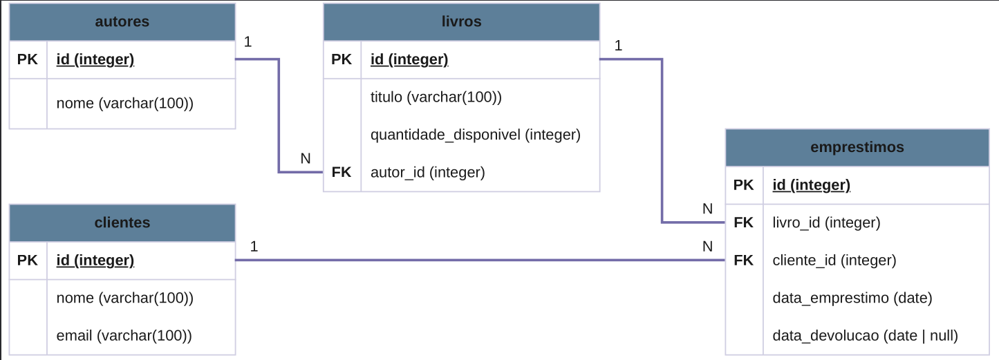

# BookStore Manager CLI

Aplicação de linha de comando para gerenciar o acervo e os empréstimos de uma biblioteca criado para o Projeto Avaliativo do curso de Back-end Node.

Desenvolvida em **Node.js** e **TypeScript**, com banco de dados relacional em **PostgreSQL**.

# Descrição

**BookStore Manager CLI** é uma aplicação que permite cadastrar autores, livros, clientes e controlar os empréstimos e devoluções do acervo, através de menus interativos no terminal de comando.

O projeto é dividido em duas partes:

1. **Aplicação em TypeScript:** armazena os dados em memória (nos repositories). Os dados são carregados no início a partir de `src/data/seed.ts`. A aplicação não guarda novos dados apos ser encerrada.
2. **Banco de dados:** o arquivo `database/script.sql` e o DER descrevem o modelo relacional em PostgreSQL. A aplicação não se conecta ao banco, porém o `src/data/seed.ts` possui os mesmos dados de exemplo que o `database/script.sql`.

Para a criação do exemplo com autores, livros, clientes e empréstimos, foram usadas músicas MPB, em que cada **autor** é um cantor, e cada **livro** é uma **música**. Apenas para diversificar os exemplos, porém os nomes das tabelas e das classes continuam sendo `autores`, `livros`, `clientes` e `emprestimos`. 

## Objetivo

Praticar a criação e design de um sistema.

- programação orientada a objetos com TypeScript.
- organização de código em camadas (controllers, services, repositories).
- programação assíncrona com `async`/`await` e `Promise`.
- tratamento de erros para não quebrar o sistema.
- modelagem e consulta de dados relacionais com SQL.
- commits padronizados e utilização do Git.


## Tecnologias utilizadas

| Tecnologia | Uso |
| :---- | :---- |
| Node.js | Ambiente de execução da aplicação |
| TypeScript | Linguagem de programação |
| PostgreSQL | Banco de dados |
| draw.io | Elaboração do diagrama |
| GitHub | Versionamento do código |


## Requisitos para execução

- **Node.js** 18 e **npm**
- **PostgreSQL** 12 ou superior - para executar o `script.sql`
- **Código** desse repositório


## Execução do script SQL no PostgreSQL

O arquivo `database/script.sql` cria o banco de dados relacional. Primeiro começa com a criação das tabelas (DDL). Em sequência (DML) insere os dados de exemplo e executa atualizações, remoções e depois consultas relacionais.

Ele pode ser executado várias vezes, pois no início as tabelas anteriores são deletadas, para poderem ser recriadas a cada execução.

**1. Criar o banco de dados**

Em Linux (com PostgreSQL):

```bash
sudo -u postgres createdb bookstore
```

**2. Executar o script**

```bash
sudo -u postgres psql -d bookstore < database/script.sql
```

Devem aparecer os livros cadastrados. Na saída da execução completa também aparecem os resultados das consultas relacionais.


## DER do banco de dados



| Tabela | Campos |
| :---- | :---- |
| `autores` | `id` (PK), `nome` |
| `clientes` | `id` (PK), `nome`, `email` (único) |
| `livros` | `id` (PK), `titulo`, `quantidade_disponivel` (>= 0), `autor_id` (FK) |
| `emprestimos` | `id` (PK), `livro_id` (FK), `cliente_id` (FK), `data_emprestimo`, `data_devolucao` (null enquanto o empréstimo está ativo) |

Relacionamentos:

- 1 **autor** possui N **livros** (1:N).
- 1 **livro** está em N **empréstimos** (1:N).
- 1 **cliente** pode fazer N **empréstimos** (1:N).


# Instalação

```bash
git clone https://github.com/SEU_USUARIO/bookstore-manager-cli.git
cd bookstore-manager-cli
npm install
```

O `npm install` baixa as dependências listadas no `package.json` e cria a pasta `node_modules/`.

## Execução da aplicação

**Modo desenvolvimento** (executa o TypeScript diretamente):

```bash
npm run dev
```

**Modo produção** (compila para JavaScript e executa o resultado):

```bash
npm run build
npm start
```

| Script | Descrição |
| :---- | :---- |
| `npm run dev` | Executa `src/main.ts` com o `tsx` |
| `npm run build` | Compila o projeto com `tsc` para a pasta `dist/` |
| `npm start` | Executa a versão compilada (`dist/main.js`) |

Ao iniciar, a aplicação carrega os dados iniciais (do `src/data/seed.ts`) e exibe o menu principal. 

Para encerrar, só escolher a opção `0` (Encerrar aplicação).
